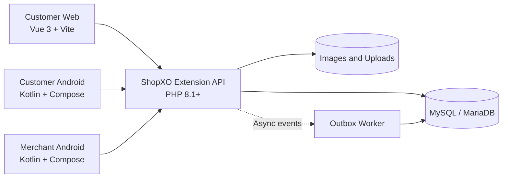

# Chunlian Fresh

[简体中文](README.md) | English

[](LICENSE)
[](apps/customer-web)
[](apps/customer-android)
[](apps/merchant-android)
[](backend/extension)

> A multi-client commerce system for owner-operated community grocery stores, connecting customers, merchants, and a ShopXO backend across ordering, fulfillment, payment reconciliation, and business reporting.

Chunlian Fresh is designed for a specific operating model: one store, a fixed supply source, and a small delivery team that may be just one person. It is not a generic multi-vendor marketplace template. The system focuses on common real-world grocery problems such as frequent order edits, fulfillment that can finish before payment, and offline refunds that require manual verification.

## At a Glance

| Area | Details |
|---|---|
| Customer channels | Mobile-first web app and native Android app |
| Merchant channel | Native Android management app; the ShopXO web admin remains available for setup and maintenance |
| Backend | ShopXO extension API, domain services, and MySQL data model |
| Payment modes | Offline QR prepayment (`OFFLINE_QR`) and cash on delivery (`COD`) |
| Deployment style | Modular monolith for low-cost, low-concurrency deployments |
| Android support | Android 7.0 (API 24) and later |

## Features

### Customer experience

- Home, categories, search, product details, fixed-SKU products, cart, and checkout.
- Customer accounts, saved delivery addresses, immediate delivery, and scheduled delivery.
- Offline QR prepayment and cash on delivery.
- Self-service order edits and cancellation before dispatch; contact the merchant after dispatch.
- Order history, order details, refund progress, and delivery confirmation.

### Merchant operations

- Operations dashboard, order filtering, fulfillment, and COD receivables.
- Manual verification of QR payments, top-ups, and refunds with an auditable ledger.
- Product, image, SKU inventory, fresh-category, and store-profile management.
- Configuration for payment QR, delivery fee, store status, and customer-facing home content.
- Business statistics, read-only financial ledger, in-app notifications, and client update checks.

### Backend and business rules

- Modular ShopXO extension with a framework-independent domain layer that can be tested separately.
- Separate order, payment, and revision states, including valid cases such as delivered but unpaid.
- Server-side validation for pricing, stock, store availability, order version, and idempotency.
- Money is stored and calculated in integer fen; order edits preserve price snapshots and ledger records.
- OpenAPI contract, database migrations, health checks, and an asynchronous outbox worker.

## Design Highlights

| Problem | Approach |
|---|---|
| Customer order edits | Allowed only before the server accepts dispatch; revisions use version checks and idempotency keys |
| Offline QR payment | Showing a QR code or screenshot never marks an order as paid; the merchant verifies the actual transfer |
| Unpaid COD orders | Delivered-but-unpaid is a valid state; the balance remains receivable instead of being counted as collected |
| Concurrent changes | Optimistic locking and transactions protect order, stock, and financial side effects |
| Monetary accuracy | APIs and domain logic use integer fen to avoid floating-point errors |
| Historical orders | Product, price, and delivery details are snapshotted when the order is created |

> [!IMPORTANT]
> This project does not integrate the WeChat Pay merchant API and does not provide automatic payment callbacks or refunds. Offline QR payments, top-ups, and refunds require manual verification.

## Architecture



The customer web and Android apps are separate implementations that share the same backend API and business rules. The customer Android app is a native Compose client, not a WebView wrapper.

## Tech Stack

| Component | Main technologies |
|---|---|
| Customer web | Vue 3, Vite, Vue Router, Pinia, TypeScript, Playwright |
| Customer Android | Kotlin, Jetpack Compose, Retrofit, OkHttp, Coroutines, DataStore |
| Merchant Android | Kotlin, Jetpack Compose, Retrofit, OkHttp, Coil, DataStore |
| Backend | PHP 8.1+, ShopXO, PDO, PHPUnit, MySQL/MariaDB |
| Infrastructure | Nginx, Shell/Python scripts, seed data, and static privacy pages |

## Repository Layout

```text
apps/
  customer-web/          Customer web application
  customer-android/      Native customer Android app
  merchant-android/      Native merchant Android app
  shared/                Shared Android update code
backend/
  extension/             Framework-independent domain, API contract, migrations, scripts
  shopxo-plugin/         ShopXO integration layer
infrastructure/          Nginx, environment templates, download/privacy pages, operations scripts
docs/                    Architecture, product, API, data model, deployment, and testing docs
```

## Getting Started

### Prerequisites

- Node.js 20+ and npm
- JDK 17, Android SDK 34, and Android Build Tools 34.0.0
- PHP 8.1+, Composer, and MySQL/MariaDB
- A working ShopXO installation for full backend integration

> No all-in-one Docker Compose environment is currently included. Each client can be developed against a compatible API, while a complete deployment requires a prepared ShopXO database, extension directories, and upload storage.

### Customer Web

```bash
cd apps/customer-web
npm ci
npm run dev
```

The development server runs at `http://localhost:5173/app/` and proxies `/api` and `/static` to `http://127.0.0.1:18096` by default. Set `VITE_API_TARGET` to use another backend.

```bash
npm run build
npm run test:e2e
```

Production builds use `/app/` as the deployment base path.

### Android Apps

Create a local, uncommitted `local.properties` file in the relevant project:

```properties
sdk.dir=<ANDROID_SDK_PATH>
API_BASE_URL=<API_BASE_URL>
```

Customer app:

```bash
cd apps/customer-android
./gradlew testDebugUnitTest assembleDebug
```

Merchant app:

```bash
cd apps/merchant-android
./gradlew testDebugUnitTest assembleDebug
```

On Windows PowerShell, use `.\gradlew.bat`. A release build also requires an HTTPS API URL and a signing properties file:

```bash
./gradlew assembleRelease -PSIGNING_PROPERTIES=/path/to/signing.properties
```

The signing file must contain `storeFile`, `storePassword`, `keyAlias`, and `keyPassword`. Never commit keystores, passwords, or `local.properties`.

### Backend and Tests

```bash
cd backend/extension
composer install
composer test
php tests/self-check.php
php scripts/migrate.php --dry-run
```

Back up the database before applying migrations, then run them explicitly with `--apply`. For the ShopXO extension layout, environment variables, PHP-FPM, worker, and HTTPS configuration, see the [deployment guide](docs/DEPLOYMENT.md).

## Testing

| Layer | Tool or command |
|---|---|
| Customer web | `npm run build`, `npm run test:e2e` |
| Customer Android | `./gradlew testDebugUnitTest`, `./gradlew lintDebug` |
| Merchant Android | `./gradlew testDebugUnitTest`, `./gradlew lintRelease` |
| Backend domain and services | `composer test`, `php tests/self-check.php` |
| Delivery verification | `infrastructure/scripts/verify-delivery.py` |

Changes involving orders, stock, money, refunds, or concurrency should include normal-flow, boundary, and repeated-submission tests. For previous acceptance coverage and remaining gaps, see [Testing](docs/TESTING.md) and the [acceptance report](docs/ACCEPTANCE-REPORT-2026-10-13.md).

## Scope and Limitations

The current version explicitly does not include:

- Multiple merchants or stores, supplier portals, WMS, rider dispatch, live GPS, or route planning.
- WeChat Pay merchant API integration, payment callbacks, automatic reconciliation, or automatic refunds.
- Weight-based pricing, advanced loyalty programs, coupon campaigns, or shipping-label integrations.
- Out-of-the-box lock-screen push notifications; GeTui support requires configuring credentials and rebuilding the clients.

Before a production deployment, complete your own security review, payment and privacy compliance review, certificate and secret management, database backup plan, and physical-device acceptance testing.

## Documentation

| Document | Purpose |
|---|---|
| [Product requirements](docs/PRD.md) | Roles, workflows, and non-negotiable business rules |
| [Architecture](docs/ARCHITECTURE.md) | Client choices, order-state model, money handling, and deployment decisions |
| [API guide](docs/API.md) | Routes, idempotency, version checks, and capability boundaries |
| [OpenAPI contract](backend/extension/api-contracts/openapi.yaml) | Machine-readable API definition |
| [Data model](docs/DATA-MODEL.md) | Tables, states, and field constraints |
| [Deployment and recovery](docs/DEPLOYMENT.md) | Environment variables, releases, migrations, and rollback |
| [Testing](docs/TESTING.md) | Acceptance checklist and test boundaries |
| [Operations guide](使用说明.md) | Day-to-day instructions for merchants and customers |

Most design documentation is currently written in Chinese.

## Contributing

Issues and pull requests are welcome. For changes that affect orders, inventory, or financial workflows, include:

1. The business invariant affected by the change.
2. Any impact on idempotency, concurrency, migrations, or compatibility.
3. Unit, API, and end-to-end verification performed.
4. Remaining scenarios or known risks.

## License

The project’s own source code is released under the [MIT License](LICENSE). ShopXO core is also MIT-licensed, but official plugins, sample assets, icons, images, and fonts may require separate commercial permissions. Verify all third-party dependencies and artwork before commercial use.
