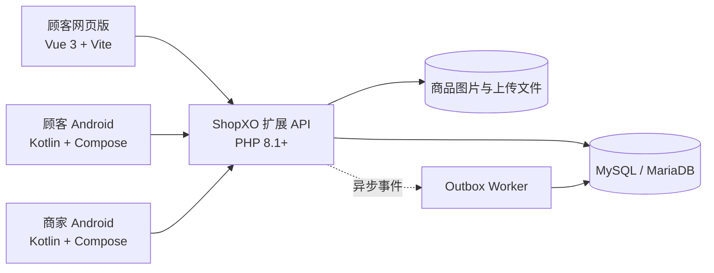

# 春连鲜选（Chunlian Fresh）

简体中文 | [English](README.en.md)

[](LICENSE)
[](apps/customer-web)
[](apps/customer-android)
[](apps/merchant-android)
[](backend/extension)

> 面向单店自营社区生鲜的多端电商系统，连接顾客、店主与 ShopXO 后端，覆盖下单、履约、收款核实和经营数据闭环。

春连鲜选聚焦「单店自营、固定货源、一人配送」的实际经营场景。项目不是通用的多商户商城模板，而是针对社区生鲜订单金额频繁变化、配送与收款并不同步、退款需要人工核实等特点设计的一套可部署应用。

## 项目概览

| 维度 | 内容 |
|---|---|
| 顾客入口 | 移动优先网页、原生 Android App |
| 商家入口 | 原生 Android 管理 App；ShopXO Web 后台用于初始化和维护 |
| 后端 | ShopXO 扩展 API、领域服务与 MySQL 数据模型 |
| 支付方式 | 线下扫码预付（OFFLINE_QR）、货到付款（COD） |
| 部署形态 | 单机模块化单体，适合低成本、低并发部署 |
| Android 支持 | Android 7.0（API 24）及以上 |

## 主要功能

### 顾客端

- 首页、分类、搜索、商品详情、固定规格 SKU、购物车与结算。
- 顾客账号、收货地址、尽快配送或预约送达。
- 线下扫码预付与货到付款。
- 开始配送前自助修改或取消订单；配送后联系店主处理。
- 订单列表、订单详情、退款进度与确认收货。

### 商家端

- 经营工作台、订单筛选、配送履约和 COD 应收管理。
- 人工核实扫码付款、补款和退款，保留对应资金流水。
- 商品、图片、SKU 库存、生鲜分类和店铺资料管理。
- 收款二维码、配送费、营业状态和首页文案配置。
- 经营统计、只读资金流水、App 内通知和客户端更新检查。

### 后端与业务规则

- 基于 ShopXO 的模块化扩展，领域层不依赖框架，可脱离 ShopXO 单独测试。
- 履约状态、支付状态和修订状态分别建模，支持「已送达但未收款」等真实状态。
- 服务端统一校验价格、库存、营业状态、订单版本和操作幂等性。
- 金额使用整数分；下单与改单保留价格快照和资金记录。
- 提供 OpenAPI 契约、数据库迁移、健康检查与异步事件 Outbox Worker。

## 业务设计重点

| 场景 | 处理方式 |
|---|---|
| 顾客修改订单 | 仅在服务端成功提交「开始配送」前允许；修订带版本号与幂等键 |
| 付款与到账 | 展示二维码或顾客截图不视为到账，必须由店主核实实际资金后再登记 |
| COD 未收款 | 「已送达 + 未收款」是有效状态，应收持续保留，不自动计入实收 |
| 并发修改 | 服务端使用乐观锁和事务处理订单、库存与资金副作用 |
| 金额计算 | API 与领域层统一使用整数分，避免浮点误差 |
| 历史订单 | 保存商品、价格和配送信息快照，后续改价不影响已提交订单 |

> [!IMPORTANT]
> 本项目不接入微信支付商户 API，不提供自动支付回调或自动退款。扫码预付、补款和退款都采用人工核实流程。

## 系统架构



顾客网页与顾客 Android 分别实现界面，共用后端 API 和业务规则；顾客 Android 为原生 Compose 客户端，不是 WebView 页面壳。

## 技术栈

| 模块 | 主要技术 |
|---|---|
| 顾客网页版 | Vue 3、Vite、Vue Router、Pinia、TypeScript、Playwright |
| 顾客 Android | Kotlin、Jetpack Compose、Retrofit、OkHttp、Coroutines、DataStore |
| 商家 Android | Kotlin、Jetpack Compose、Retrofit、OkHttp、Coil、DataStore |
| 后端 | PHP 8.1+、ShopXO、PDO、PHPUnit、MySQL/MariaDB |
| 基础设施 | Nginx、Shell/Python 运维脚本、种子数据与隐私政策静态页 |

## 目录结构

```text
apps/
  customer-web/          顾客网页版
  customer-android/      顾客原生 Android App
  merchant-android/      商家原生 Android App
  shared/                两端共享的 Android 更新代码
backend/
  extension/             框架无关的领域层、API 契约、迁移与脚本
  shopxo-plugin/         ShopXO 插件接入层
infrastructure/          Nginx、环境模板、下载页、隐私页与运维脚本
docs/                    架构、产品、API、数据模型、部署和测试文档
```

## 快速开始

### 环境要求

- Node.js 20+ 与 npm
- JDK 17、Android SDK 34、Android Build Tools 34.0.0
- PHP 8.1+、Composer、MySQL/MariaDB
- 一套可运行的 ShopXO 实例（完整后端联调需要）

> 仓库目前不提供一键启动全套服务的 Docker Compose。各客户端可以连接兼容的 API 独立开发；完整运行需要准备 ShopXO 数据库、扩展目录和上传目录。

### 顾客网页版

```bash
cd apps/customer-web
npm ci
npm run dev
```

开发服务器默认运行在 `http://localhost:5173/app/`，并将 `/api` 和 `/static` 代理到 `http://127.0.0.1:18096`。连接其他后端时设置 `VITE_API_TARGET`。

```bash
npm run build
npm run test:e2e
```

生产构建使用 `/app/` 作为部署基础路径。

### Android App

在对应工程根目录创建不提交 Git 的 `local.properties`：

```properties
sdk.dir=<ANDROID_SDK_PATH>
API_BASE_URL=<API_BASE_URL>
```

顾客端：

```bash
cd apps/customer-android
./gradlew testDebugUnitTest assembleDebug
```

商家端：

```bash
cd apps/merchant-android
./gradlew testDebugUnitTest assembleDebug
```

Windows PowerShell 使用 `.\gradlew.bat`。正式 Release 构建还要求 HTTPS API 地址和签名配置文件：

```bash
./gradlew assembleRelease -PSIGNING_PROPERTIES=/path/to/signing.properties
```

签名文件至少包含 `storeFile`、`storePassword`、`keyAlias` 和 `keyPassword`。不要把密钥、口令或 `local.properties` 提交到仓库。

### 后端与测试

```bash
cd backend/extension
composer install
composer test
php tests/self-check.php
php scripts/migrate.php --dry-run
```

正式迁移前必须备份数据库，并使用 `--apply` 显式执行。把 `backend/extension`、`backend/shopxo-plugin/chunlianfresh` 接入 ShopXO 的目录结构、环境变量、PHP-FPM、异步任务和 HTTPS 配置请参阅 [部署文档](docs/DEPLOYMENT.md)。

## 测试

| 层级 | 工具或命令 |
|---|---|
| 顾客网页 | `npm run build`、`npm run test:e2e` |
| 顾客 Android | `./gradlew testDebugUnitTest`、`./gradlew lintDebug` |
| 商家 Android | `./gradlew testDebugUnitTest`、`./gradlew lintRelease` |
| 后端领域与服务 | `composer test`、`php tests/self-check.php` |
| 部署与交付 | `infrastructure/scripts/verify-delivery.py` |

涉及订单、库存、金额、退款或并发逻辑的改动，应同时补充正常流程、边界值和重复提交测试。历史验收范围与未验证项见 [测试说明](docs/TESTING.md) 和 [验收报告](docs/ACCEPTANCE-REPORT-2026-10-13.md)。

## 项目边界

当前版本明确不包含：

- 多商户、多门店、供应商平台、WMS、骑手调度、实时 GPS 或路线规划。
- 微信支付商户 API 接入、支付回调、自动对账或自动退款。
- 按称重计价、复杂会员积分、优惠券营销、电子面单等扩展能力。
- 开箱即用的系统锁屏推送；个推能力需要自行配置凭据并重新构建客户端。

部署到生产环境前，请重新完成安全审查、支付与隐私合规检查、证书和密钥管理、数据库备份以及真实设备验收。

## 文档

| 文档 | 内容 |
|---|---|
| [产品需求](docs/PRD.md) | 角色、业务流程与不可妥协的业务规则 |
| [系统架构](docs/ARCHITECTURE.md) | 多端选型、订单状态、金额与部署决策 |
| [API 说明](docs/API.md) | 路由、幂等、版本校验与能力边界 |
| [OpenAPI 契约](backend/extension/api-contracts/openapi.yaml) | 机器可读接口定义 |
| [数据模型](docs/DATA-MODEL.md) | 数据表、状态和字段约束 |
| [部署与恢复](docs/DEPLOYMENT.md) | 环境变量、发布、迁移与回滚 |
| [测试说明](docs/TESTING.md) | 验收清单与测试边界 |
| [使用说明](使用说明.md) | 店主与顾客的实际操作指引 |

## 参与贡献

欢迎提交 Issue 和 Pull Request。涉及订单、库存或资金流程的改动，请在提交中说明：

1. 影响到的业务不变量；
2. 幂等、并发、迁移与兼容性影响；
3. 已执行的单元测试、接口测试和端到端验证；
4. 仍未覆盖的场景或已知风险。

## 许可证

本项目自有代码采用 [MIT License](LICENSE)。ShopXO 核心同样使用 MIT 许可，但官方插件、示例素材、图标、图片和字体的商业使用授权需要单独核对。正式商用前请确认所有第三方依赖与美术资源的使用条件。
