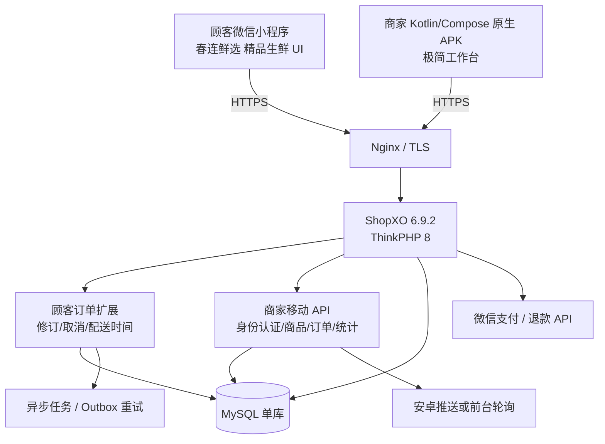

# 部署手册｜春连鲜选

> 来源：方案 §13、§20.1。本手册可直接交给运维照单执行。

## 1. 生产拓扑



## 2. 资源规格

| 资源 | 起步建议 | 备注 |
|---|---|---|
| 云服务器 | 2 vCPU / 4GB RAM / 40–60GB SSD | 单店、低并发先用一台 |
| 系统 | Ubuntu LTS | 实际需按 ShopXO 依赖兼容性选择 |
| Web | Nginx + PHP-FPM | 强制 HTTPS |
| PHP | 按锁定 ShopXO 版本与 composer 兼容性选择受支持版本 | 不直接指定未经验证的最新版本 |
| 数据库 | MySQL 8.x 或项目验证支持的维护版本 | 只监听内网/本机 |
| 缓存 | 优先使用 ShopXO 已验证的缓存方案 | 不强加 Redis |
| 文件 | 首期本地上传目录 + 异地备份 | 增长后迁对象存储 |
| 通知重试 | Cron + 数据库 outbox 单 worker | 不必 Kafka/RabbitMQ |
| SSL | ACME/Let's Encrypt（适用时） | 域名和证书自动续期 |

## 3. 环境区分

| 环境 | 说明 |
|---|---|
| **dev** | 本地容器或虚拟机，假支付、假退款、**不存真实个人信息** |
| **staging** | 与生产结构接近，有微信/商户测试能力时做支付联调与 APK 真机测试 |
| **prod** | 正式域名、正式商户号、独立数据库和备份目标；**不要在生产直接改源码调试** |

生产域名示例（**不是已购买域名**）：`api.example.cn`（商城 API/必要图片）、`admin.example.cn`（ShopXO 高级后台）。可共用同一台云服务器，API 与后台使用不同入口、严格访问控制；首次版本不强制 CDN / Redis / 分布式服务。

## 4. 部署执行顺序（Runbook）

1. 确认经营主体、小程序 AppID、域名、服务器区域、备案与支付商户号条件。
2. 开通云服务器，建议 2 vCPU / 4GB RAM / SSD 40–60GB 起步；管理入口仅授权本人；安全组只放行 `22/80/443`，**数据库 3306 不向公网放行**。
3. 创建非 root 运维账号 + SSH 密钥登录，禁用密码登录。
4. 安装 Nginx、PHP-FPM、MySQL、所需扩展及证书；按官方要求配置站点根目录到 `public/`，禁止暴露敏感目录。
5. 从 GitHub 克隆**指定 ShopXO commit/tag**，记录依赖版本和文件校验；**不要生产环境直接跟踪 `master`**。
6. `composer install --no-dev --optimize-autoloader`，使用锁定依赖和生产模式，配置站点 `public` 根目录、HTTPS、重写规则、写权限和环境密钥。
7. 创建数据库并安装 ShopXO，开启 HTTPS，检查后台登录、商品 CRUD、原生购物车、订单和微信小程序 API。
8. 配置 COD 支付方式、开启后台「线下支付正常进行」与「下单指定时间」，核对缓存清理、原生预约时间功能。
9. 按顺序部署扩展：**备份 → 迁移 `veg_*` 表 → 缓存更新 → 健康检查**：

   ```bash
   cd backend-extension
   php scripts/migrate.php --dry-run       # 先预演
   php scripts/migrate.php --apply         # 正式执行
   ```

10. 启动定时任务：

    ```bash
    # crontab -e （运维账号）
    * * * * * cd /var/www/chunlian/backend-extension && php scripts/outbox-worker.php --once >> /var/log/chunlian/outbox.log 2>&1
    */5 * * * * cd /var/www/chunlian/backend-extension && php scripts/payment-verify.php >> /var/log/chunlian/payment.log 2>&1
    0 3 * * * /var/www/chunlian/infrastructure/backup/backup_db.sh >> /var/log/chunlian/backup.log 2>&1
    ```

    > **禁止在 HTTP 请求内无限重试**。

11. 构建顾客微信小程序：设置正确的 AppID、API/静态域名，在微信公众平台配置合法服务器域名，真机测试后上传微信开发者工具 → 体验版 → 审核 → 发布。
12. 构建原生安卓管理端：Android Studio 检查 `applicationId`、Release HTTPS Base URL、签名与版本号；用 Gradle 编译已签名 Release APK，手机安装并测试原生业务页面和推送权限。
13. 微信支付商户号及密钥**仅保存在服务器安全配置中**；用**小额真实测试订单**验证回调、查单、退款及对账；按交易类小程序要求完成订单发货信息上报/管理适配。
14. 开启监控与备份：每天备份数据库 + 商品图片到**另一存储位置**，数据库备份加密，定期恢复演练；设置错误日志采样、告警和磁盘容量阈值。
15. 建立灰度/回滚流程：保留上一个稳定 APK、小程序版本、后端构建与数据库备份；迁移需说明正向修复及兼容回滚路径。

## 5. 环境变量模板

见 `infrastructure/.env.example`。关键项：

| 变量 | 说明 |
|---|---|
| `APP_ENV` | `dev` / `staging` / `prod` |
| `APP_URL` | 正式 HTTPS 域名 |
| `DB_HOST` `DB_PORT` `DB_NAME` `DB_USER` `DB_PASS` | 数据库（仅内网监听） |
| `WXPAY_MCHID` `WXPAY_SERIAL_NO` `WXPAY_PRIVATE_KEY_PATH` `WXPAY_APIV3_KEY` | 微信支付商户配置 |
| `WXPAY_NOTIFY_URL` | 支付回调地址 |
| `MERCHANT_API_SECRET` | 商家 API 会话签名密钥 |
| `UPLOAD_MAX_MB` | 图片上传上限 |
| `BUSINESS_TIMEZONE` | 经营时区，默认 `Asia/Shanghai` |

> **所有密钥不提交 Git，不嵌入小程序和 APK。**

## 6. Nginx 配置要点

见 `infrastructure/nginx/chunlian.conf`。核心：

- `root /var/www/chunlian/shopxo/public;`（**不暴露仓库根目录**）
- 强制 HTTPS + HSTS
- 拒绝访问 `.env`、`.git`、`vendor`、`runtime`、`*.sql`、`*.md`
- PHP-FPM 限制 `max_execution_time`，避免支付回调超时
- `/api/v1/webhook/*` 单独限速规则，避免被刷

## 7. 备份与运维

### 7.1 备份策略

| 对象 | 频率 | 保留 | 位置 |
|---|---|---|---|
| MySQL 全量 | 每日 | 7–30 天 | **异地存储**（对象存储/另一台机器） |
| 商品图片目录 | 每日增量 | 30 天 | 异地存储 |
| 代码 / 配置 | 每次发布 | 全部版本 | Git 私有仓库 |

> **不得只在原服务器存备份。**

### 7.2 监控项

- 接口错误率、5xx 数量
- CPU / 内存 / 磁盘使用率
- 数据库连接数、慢查询
- 支付回调失败数、退款任务失败数
- `veg_outbox_event` 中 `status='DEAD'` 的数量
- 待处理订单数量（长时间 `PENDING` 告警）

### 7.3 升级流程

```
备份 → staging 验证 → 执行迁移（先 --dry-run） → 发布后观察 → 出问题回滚代码并按迁移策略恢复/补偿数据
```

### 7.4 日常维护

- 打安全补丁
- 检查订单通知（`veg_outbox_event` 积压）
- 检查支付对账（微信商户平台 vs `veg_payment_ledger`）
- 保留日志但**脱敏**（不打印完整手机号/地址/密钥）

## 8. 发布门槛

以下全部通过才可发布：

- [ ] T01–T30 核心业务测试通过
- [ ] U01–U14 UI 检查通过
- [ ] Android 原生核验通过（无 WebView 套壳）
- [ ] 支付/退款资金对账通过
- [ ] 备份恢复演练通过
- [ ] 微信审核条件满足

> 微信审核及支付开通时间**不受开发排期完全控制**。
